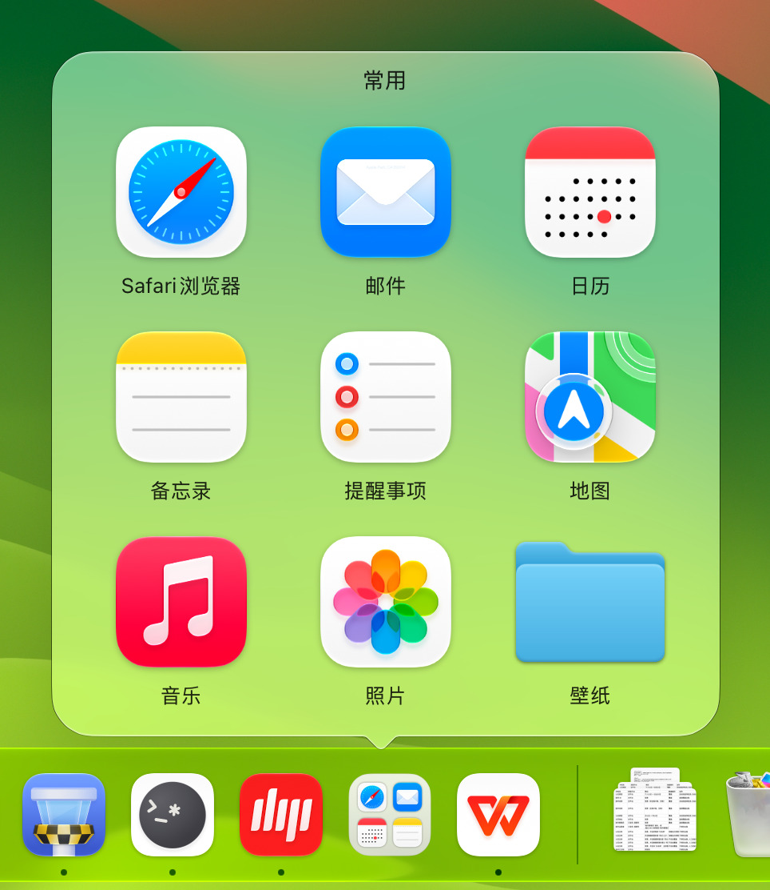
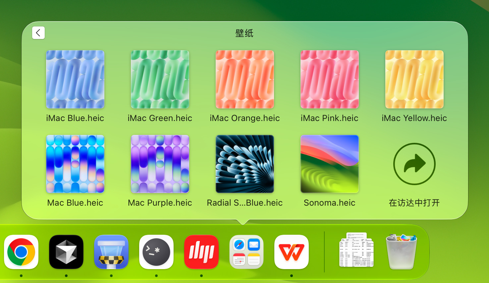
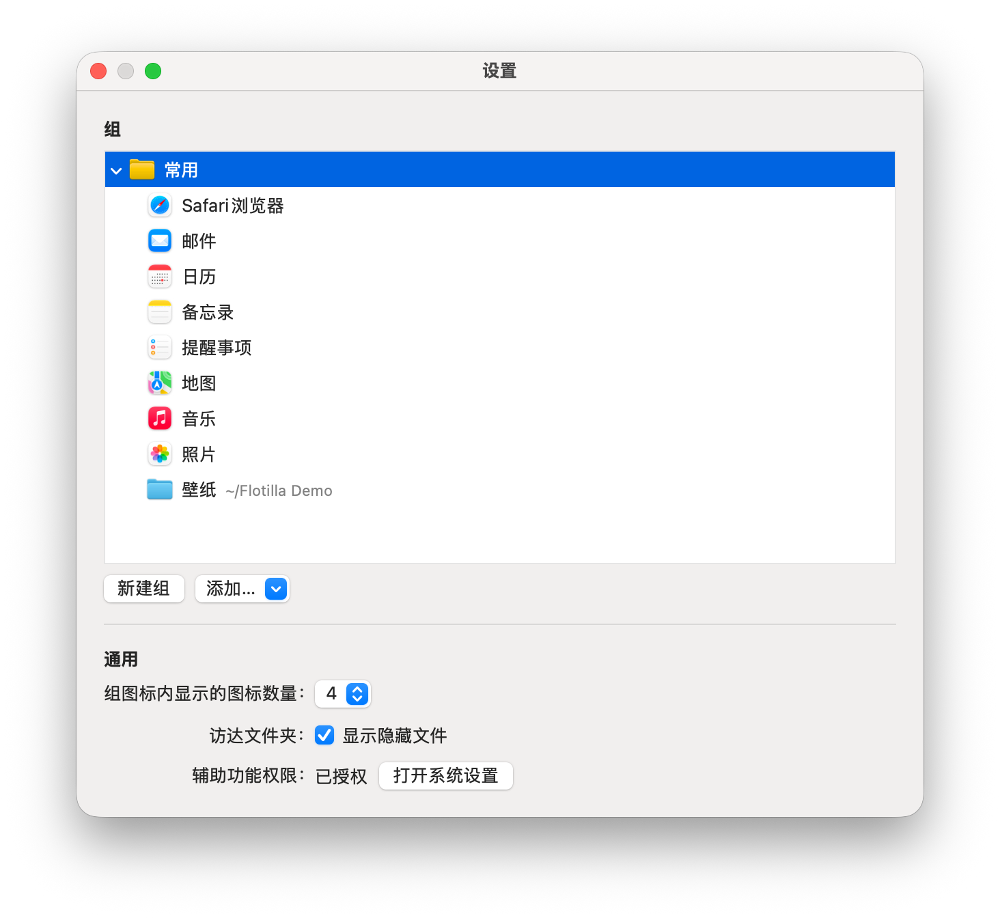

<p align="center">
  <picture>
    <source media="(prefers-color-scheme: dark)" srcset="docs/resources/readme-header-zh-dark.png">
    
  </picture>
</p>

<div align="center">

[English](README.md) | 简体中文

在 Dock 上给应用分组，文件、文件夹和网页也能放进去。

[](https://flotilla.rakuyo.dev/zh/)
[](https://github.com/rakuyoMo/Flotilla/actions/workflows/ci.yml)


[](LICENSE)

</div>

<p align="center">
  <picture>
    <source media="(prefers-color-scheme: dark)" srcset="docs/resources/screenshot-panel-zh-dark.jpg">
    
  </picture>
</p>

## 简介

Dock 自带的文件夹只能放在右侧，而且每个都对应磁盘上的一个文件夹。

归帆（Flotilla）的组可以放在 Dock 左侧，和应用并排显示。应用、文件、文件夹和网页都能加入同一个组。

分组不会移动原来的应用和文件，也不需要在磁盘上新建文件夹。

点击组图标，组里的内容会以网格形式展开，外观和动画与 Dock 自带的文件夹一致。

应用名称会随系统语言变化：简体中文显示 “归帆”，繁体中文显示 “歸帆”，日文显示 “帰帆”，其它语言显示 “Flotilla”。

## 功能

- **和应用并排显示**：每个顶层组都有自己的名称和图标，和应用并排显示在 Dock 左侧

- **应用、文件和网页**：应用、文件、文件夹和网页可以放在一起。文件用默认应用打开，网页用默认浏览器打开

- **组里还能分组**：点击子组进入下一层，点击返回按钮回到上一层

- **原生风格的面板**：组会在 Dock 上方以网格展开，面板与组图标对齐

- **直接浏览文件夹**：文件夹可以直接在当前面板里展开，并显示文件缩略图。网格末尾有 “在访达中打开”，设置里也可以开启 “显示隐藏文件”

- **预览组内图标**：组图标会显示前几项的图标，最多 4 个，数量可在设置中调整。底板随系统切换浅色和深色外观

- **拖放添加**：把应用、文件或文件夹拖到 Dock 上的组图标，或拖到设置窗口里的组。网页也可以拖到设置窗口里添加

- **拖动排序和移除**：在面板里拖动项目可以排序。要移除某一项，把它拖出面板，等 “移除” 提示出现后松手

- **移动或改名后仍能打开**：移动或改名后，应用和文件仍能从组里打开。应用更新后也会打开已安装的新版本

- **在后台运行**：归帆在菜单栏运行。展开面板时不会抢走当前应用的焦点，也不会在 Dock 上多出归帆的图标

- **支持五种语言**：英文、简体中文、繁体中文、日文和韩文，自动跟随系统语言。其它语言环境下显示英文

<p align="center">
  <picture>
    <source media="(prefers-color-scheme: dark)" srcset="docs/resources/screenshot-stack-zh-dark.jpg">
    
  </picture>
</p>

## 安装

归帆支持搭载 Apple 芯片、运行 macOS 15 或更高版本的 Mac。

1. 在 [官网](https://flotilla.rakuyo.dev/zh/download/) 或 [Releases](https://github.com/rakuyoMo/Flotilla/releases) 页面下载最新版本的 `Flotilla-X.Y.Z.zip`
2. 双击解压，把 `Flotilla.app` 拖到 “应用程序” 文件夹
   - 访达会按系统语言显示应用名称，简体中文下显示为 “归帆”
3. 打开归帆

### 第一次打开

归帆尚未经过 Apple 公证，所以第一次打开时，macOS 会拦截它，并提示无法验证它是否包含恶意软件。

点击 “完成” 关闭提示，再按下面的步骤允许打开：

1. 打开 “系统设置 › 隐私与安全性”
   - macOS 27 里这一页是 “隐私与安全”
2. 向下滚动到 “安全性”，找到归帆被阻止的提示，点击 “仍要打开”
   - 这个按钮只在尝试打开归帆之后的一小时内出现
3. 按提示输入登录密码确认

之后就能正常打开归帆。

如果习惯用终端，也可以运行下面的命令，移除隔离属性后再打开归帆：

```bash
xattr -d com.apple.quarantine /Applications/Flotilla.app
```

### 更新

在菜单栏选择 “归帆 › 检查更新…” 可检查 GitHub Release，有新版本时会显示更新说明链接和安装入口。

设置中的 “软件更新” 提供自动检查、自动下载并在退出时安装，以及每小时、每天、每周的检查频率。默认每天自动检查，自动下载安装默认关闭；也会显示上次检查时间。

## 权限说明

### 辅助功能

辅助功能权限让归帆能够读取 Dock 的界面信息，用于：

- 确定组图标的位置，让面板准确对齐
- 和 Dock 自带的文件夹一样，在松开鼠标时立即展开面板

不开启这项权限也能使用，但会有两点区别：

- 面板会出现在点击时的鼠标位置附近，可能无法准确对齐组图标
- 点击后，面板展开会稍慢一些

开启方式：

- 尚未授权时，每次启动归帆后首次点击组图标，系统都会提示授权
- 在 “系统设置 › 隐私与安全性 › 辅助功能” 中为归帆开启权限
  - macOS 27 里这一页是 “隐私与安全 › 设备控制和数据访问”

归帆使用 ad-hoc 签名，更新后可能需要重新开启这项权限。

### 文件与文件夹

第一次在面板中打开 “文稿” “桌面” “下载” 等位置的文件夹时，macOS 会询问是否允许访问。允许后，归帆才能读取并显示里面的内容。

## 快速上手

点击菜单栏的帆船图标，选择 “设置…” 来管理组。同一菜单里还有 “退出归帆”。

<p align="center">
  <picture>
    <source media="(prefers-color-scheme: dark)" srcset="docs/resources/screenshot-settings-zh-dark.png">
    
  </picture>
</p>

### 新建组

1. 在 “组” 下点击 “新建组”，输入名称后按回车
   - Dock 会短暂重启，然后在左侧的应用区域显示组图标
   - 想在某个组里继续分组，先选中它再新建。子组会显示在上一级的面板里，不会单独占用 Dock 图标

2. 选中组，点击 “添加…”，选择要放进去的内容：
   - “添加 App…”：选择应用
   - “添加文件…”：选择文件或文件夹
   - “添加网页…”：输入网址，也可以填写标题。留空时，归帆会自动获取网页标题

3. 也可以直接拖入内容：
   - 把访达里的应用、文件或文件夹，或者浏览器里的网页，拖到设置窗口中的组上
   - 应用、文件和文件夹也能直接拖到 Dock 上的组图标。网页需要在设置窗口里添加

### 使用面板

- 点击 Dock 上的组图标展开面板，再点击要打开的应用、文件或网页
- 点击子组或文件夹进入，点击返回按钮回到上一级
- 再次点击组图标、点击面板外，或按 Esc，都能收起面板
- 拖动组内的项目来调整顺序
- 要移除某一项，把它拖出面板，等 “移除” 出现后再松手
  - 这只会把它从组里移除，应用或文件本身仍留在原处
  - 如果提前松手，它会回到原位

### 管理组

在设置窗口里：

- 双击组即可重命名
- 拖动列表中的项目可以调整顺序，也可以把它移到其它组里
- 右键点击一项，或按住 Control 点击，可以看到更多操作：
  - 组：“添加到 Dock” “删除”
  - 应用、文件或文件夹：“在访达中显示” “删除”
  - 网页：“在默认浏览器中打开” “编辑…” “删除”
- 删除组时，组和里面的条目会一起删除，不会再次询问；原来的应用和文件不受影响
- 文件夹名称后会显示所在位置，网页名称后会显示网址

想从 Dock 移除组图标，直接把它拖出去即可。组会保留在设置窗口里，并标记为 “不在 Dock 上”，不会自动加回。需要时，右键点击这个组，选择 “添加到 Dock” 就能恢复图标。

### 设置

在 “通用” 中可以调整：

- “组图标内显示的图标数量”：选择预览多少项内容，范围为 0–4。设为 0 时只显示组图标
- “访达文件夹：显示隐藏文件”：浏览文件夹时，一并显示隐藏文件
- “辅助功能权限”：查看授权状态，点击 “打开系统设置” 可以前往授权。详见 [辅助功能](#辅助功能)

## 工作原理

### Dock tile

Dock 上的每个图标对应一个 tile。为了让组能出现在应用区域，归帆会为每个顶层组生成一个占位 App，再把它加入 Dock，使用组的名称和图标。

点击图标后，Dock 会启动这个占位 App。它通过 `flotilla://` URL 通知归帆展开或收起面板，然后退出，整个过程不会把其它应用带到前台。如果归帆还没运行，系统会先启动它。

拖到组图标上的内容也由占位 App 转交给归帆。

### Dock 偏好

归帆通过修改 Dock 偏好（`com.apple.dock`）来管理组图标：

- 只修改归帆自己的 tile，它们位于 `persistent-apps`，也就是 Dock 左侧的应用区域。其它图标和 Dock 设置不受影响
- 修改后会结束 Dock 进程，macOS 随即自动重启 Dock，让改动生效
  - 图标更新也需要重启 Dock，包括组内预览变化，以及系统切换浅色或深色外观时
- 每次启动归帆后，首次修改 Dock 偏好之前，都会先导出完整的 `com.apple.dock` 备份
  - 位置：`~/Library/Application Support/Flotilla/Backups/com.apple.dock-<yyyyMMdd-HHmmss>.plist`
  - 最多保留最新的 5 份

### 数据与设置

数据保存在 `~/Library/Application Support/Flotilla`：

- `folders.json`：组的数据
- `DockTiles/`：各个顶层组对应的占位 App
- `Backups/`：Dock 偏好的备份

设置保存在偏好设置域 `com.rakuyo.flotilla`。

### 联网

归帆在添加或编辑网页时联网获取标题，也会连接 GitHub Release 检查和下载更新。自动检查可在 “软件更新” 设置中关闭。

## 从源码构建

构建需要 Xcode Command Line Tools 和 [mise](https://mise.jdx.dev)，不用安装完整的 Xcode。

Command Line Tools 需要 26 或更高版本，包含 Swift 6.2 和 macOS 26 SDK。虽然 `Package.swift` 声明的工具版本是 6.1，但面板在 macOS 26 上使用了 `NSGlassEffectView`，构建时需要 macOS 26 SDK。

项目使用 Swift Package Manager 管理。为了能只用 Command Line Tools 开发：

- 界面用 AppKit 代码编写，因为工具链没有附带 SwiftUI 宏插件
- 测试使用 Swift Testing，因为工具链没有附带 XCTest
- 不使用 asset catalog、storyboard 和 xib，因为工具链没有 `actool` 和 `ibtool`

详见 [AGENTS.md](AGENTS.md) 的 “Command Line Tools 的限制”。

```bash
# 编译 debug 版本
mise run build

# 编译 release 版本，打包为 build/Flotilla.app 并 ad-hoc 签名
mise run bundle

# 启动打包好的 App
open build/Flotilla.app
```

构建时会出现两条 `ld: warning: search path ... not found` 警告，可以忽略。它们指向的是 Command Line Tools 没有提供的目录。

## 开发

### 测试

```bash
swift test
```

- 偶尔会因 `plugin for module 'TestingMacros' not found` 编译失败，重新运行即可。刚运行过 `mise run swift:format` 时更容易遇到
- 在 git worktree 中运行时，需要显式指定插件目录：

  ```bash
  swift test -Xswiftc -plugin-path -Xswiftc /Library/Developer/CommandLineTools/usr/lib/swift/host/plugins/testing
  ```

### 代码规范

代码风格以 [RakuyoKit/swift](https://github.com/RakuyoKit/swift) 为准。

```bash
# 按代码规范自动格式化
mise run swift:format

# 检查代码规范
mise run swift:lint
```

### 日志

zsh 自带一个 `log` 命令。要查看系统日志，请使用完整路径 `/usr/bin/log`：

```bash
/usr/bin/log show --last 5m --predicate 'subsystem == "com.rakuyo.flotilla"'
```

### 开发时的辅助功能权限

- 本地打包使用 ad-hoc 签名，重新打包后可能需要再次授予辅助功能权限
- 可以用下面两种启动方式，分别测试有权限和无权限时的行为：
  - 在终端直接运行 `build/Flotilla.app/Contents/MacOS/Flotilla`，会使用终端的辅助功能权限
  - 用 `open build/Flotilla.app` 启动，会使用归帆自己的权限

### 单实例

同一 bundle ID 的归帆只能同时运行一份。如果已有实例在运行，再次启动只会激活原来的实例，新进程会随即退出。

启动 `build/Flotilla.app` 之前，先退出已安装的归帆。

### Dock 偏好

调试时修改 Dock 偏好之前，先备份：

```bash
defaults export com.apple.dock <文件>
```

### 发布与更新签名

`Sources/Flotilla/Info.plist` 中的 `CFBundleShortVersionString` 是 `X.Y.Z` 格式的展示版本；`CFBundleVersion` 是独立的正整数构建号。`mise run release X.Y.Z` 更新展示版本，并将构建号增加 `1`；Sparkle 按构建号比较新旧版本。

发布 workflow 将 `Flotilla-X.Y.Z.zip` 和签名的 `appcast.xml` 一起上传到 GitHub Release。App 从最新 Release 获取清单，下载后先验证 Ed25519 签名，再解压安装。

签名私钥须与 `Info.plist` 的 `SUPublicEDKey` 配对：CI 从仓库 secret `SPARKLE_PRIVATE_KEY` 读取；本机从钥匙串的 `com.rakuyo.flotilla` 账户读取。私钥由 Sparkle 的 `generate_keys` 工具管理。

```bash
# 打包后生成更新包与签名清单，输出到 build/updates/
mise run bundle
mise run appcast
```

Sparkle 的许可声明随 App 放在 `Contents/Resources/Sparkle-LICENSE.txt`。

### 官网

[官网](https://flotilla.rakuyo.dev/zh/) 的源码在 `website/`，构建后部署到 GitHub Pages。详细说明见 [AGENTS.md](AGENTS.md) 的 “官网” 一节。

```bash
# 组装官网到 build/site/
mise run site:build

# 组装后在本机预览，地址为 http://localhost:8000/
mise run site:preview
```

构建官网时会用 `gh` 获取版本信息，请先运行 `gh auth login` 登录。

## 参与贡献

- 提交 PR 前，请运行 `mise run swift:lint` 和 `swift test`，确认都能通过。CI 也会运行这两项检查，并编译、打包应用
- 分支命名和提交信息等约定见 [AGENTS.md](AGENTS.md)
- 各项功能的具体要求见 [docs/requirements](docs/requirements)

## 许可证

归帆以 [GNU General Public License v3.0](LICENSE) 许可证发布。
