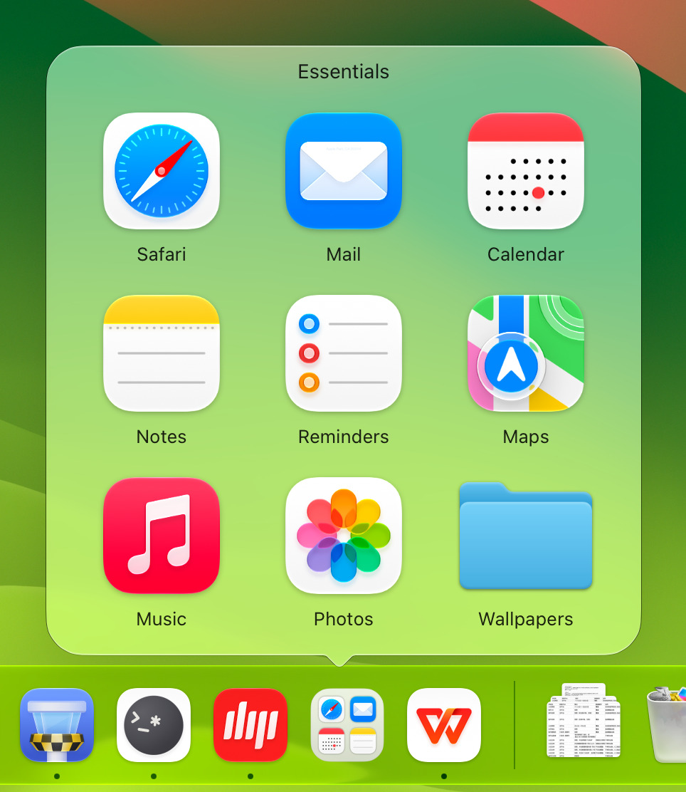
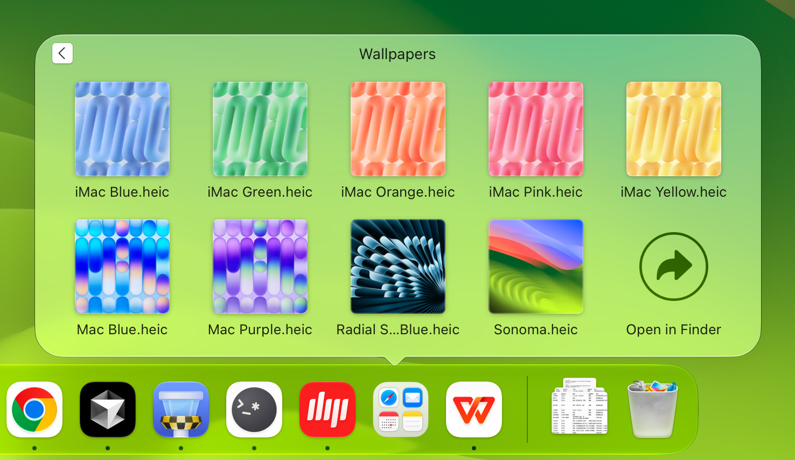
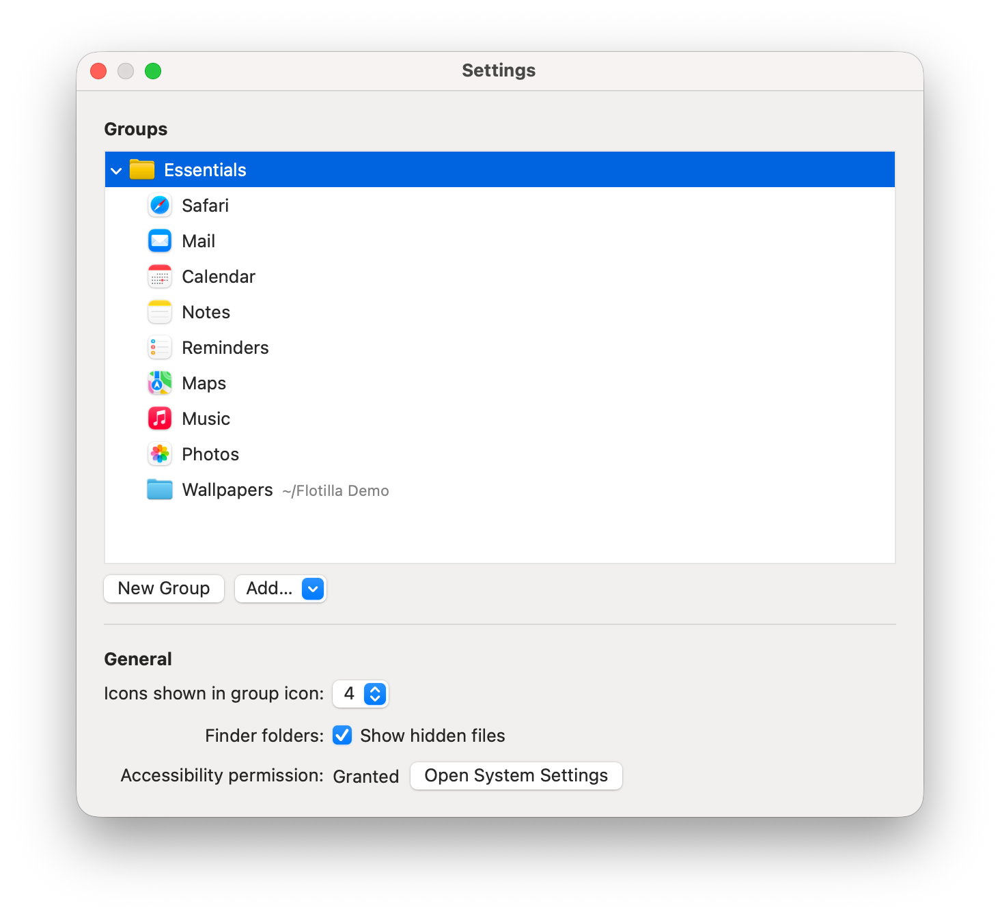

<p align="center">
  <picture>
    <source media="(prefers-color-scheme: dark)" srcset="docs/resources/readme-header-en-dark.png">
    
  </picture>
</p>

<div align="center">

English | [简体中文](README-ZH.md)

Group apps, files, folders, and web pages in your Mac's Dock.

[](https://flotilla.rakuyo.dev/)
[](https://github.com/rakuyoMo/Flotilla/actions/workflows/ci.yml)


[](LICENSE)

</div>

<p align="center">
  <picture>
    <source media="(prefers-color-scheme: dark)" srcset="docs/resources/screenshot-panel-en-dark.jpg">
    
  </picture>
</p>

## About

The Dock's own folders sit on the right and show the contents of a folder on disk.

Flotilla groups sit alongside your apps on the left side of the Dock. A group can hold apps, files, folders, and web pages.

Grouping doesn't move your apps or files, and you don't need to create any folders on disk.

Click a group icon to open a grid with the same look and animations as the Dock's built-in folders.

The app's name follows your system language: 归帆 in Simplified Chinese, 歸帆 in Traditional Chinese, 帰帆 in Japanese, and Flotilla in other languages.

## Features

- **Groups alongside your apps**: each top-level group appears on the left side of the Dock with its own name and icon

- **Apps, files, and web pages**: keep apps, files, folders, and web pages together. Files open in their default app, and web pages open in your default browser

- **Groups within groups**: open a subgroup to browse it, then use the back button to return

- **Grid view**: groups open in a grid above the Dock, aligned with their icons

- **Browse folders in place**: folders open in the same panel, with file thumbnails. The grid includes **Open in Finder**, and you can enable **Show hidden files** in settings

- **Group icon previews**: the group icon previews the first few items, up to four. You can adjust the number in settings. Its background follows your Mac's light or dark appearance

- **Drag and drop**: drop apps, files, or folders onto a group icon in the Dock or a group in the settings window. You can drop web pages into the settings window too

- **Reorder and remove**: drag items in the panel to reorder them. To remove one, drag it outside, wait for **Remove** to appear, then let go

- **Keeps track of your items**: apps and files still open from a group after you move or rename them. After an app update, Flotilla opens the newly installed version

- **Runs in the background**: Flotilla runs in the menu bar and stays out of the Dock, even when a panel is open. Panels don't take focus away from your current app

- **Five languages**: English, Simplified Chinese, Traditional Chinese, Japanese, and Korean. The app uses your system language, or English if that language isn't supported

<p align="center">
  <picture>
    <source media="(prefers-color-scheme: dark)" srcset="docs/resources/screenshot-stack-en-dark.jpg">
    
  </picture>
</p>

## Installation

Flotilla runs on Macs with Apple silicon and macOS 15 or later.

1. Download the latest `Flotilla-X.Y.Z.zip` from the [website](https://flotilla.rakuyo.dev/download/) or the [Releases](https://github.com/rakuyoMo/Flotilla/releases) page
2. Double-click to unzip it, then drag `Flotilla.app` into the Applications folder
   - Finder uses the app's name in your system language, such as 归帆 in Simplified Chinese
3. Open Flotilla

### First launch

Flotilla hasn't been notarized by Apple, so macOS blocks it the first time you try to open it. The alert says Apple cannot verify that it is free of malware.

Click **Done** to dismiss the alert, then follow these steps to open Flotilla:

1. Open **System Settings › Privacy & Security**
2. Scroll down to **Security**, find the message about Flotilla being blocked, and click **Open Anyway**
   - This button only appears for an hour after you try to open Flotilla
3. Confirm with your login password when prompted

You can now open Flotilla normally.

If you prefer Terminal, run this command to remove the quarantine attribute, then open Flotilla:

```bash
xattr -d com.apple.quarantine /Applications/Flotilla.app
```

## Permissions

### Accessibility

Accessibility access lets Flotilla read the Dock's interface so it can:

- Locate the group icon so the panel can line up with it
- Open the panel as soon as you release the mouse button, just like a Dock folder

You can use Flotilla without this permission, with two differences:

- The panel appears near the pointer and may not line up exactly with the group icon
- The panel takes a little longer to open after a click

To enable it:

- If access hasn't been granted, macOS prompts you the first time you click a group icon after each launch of Flotilla
- Enable Flotilla in **System Settings › Privacy & Security › Accessibility**
  - On macOS 27, this page is **Privacy & Security › Device Control and Data Access**

Because Flotilla uses ad-hoc signing, you may need to enable this permission again after an update.

### Files and folders

The first time you open a folder in Documents, Desktop, Downloads, or another protected location through Flotilla, macOS asks for access. Flotilla needs your permission to read and display the folder's contents.

## Getting started

Click the sailing ship in the menu bar and choose **Settings…** to manage your groups. **Quit Flotilla** is in the same menu.

<p align="center">
  <picture>
    <source media="(prefers-color-scheme: dark)" srcset="docs/resources/screenshot-settings-en-dark.png">
    
  </picture>
</p>

### Create a group

1. Under **Groups**, click **New Group**, type a name, and press Return
   - The Dock briefly restarts, then shows the group icon in the app section on the left
   - To create a group inside another group, select the parent first. The subgroup appears in its parent's panel and doesn't get a separate Dock icon

2. Select the group, click **Add…**, and choose what to put in it:
   - **Add Apps…**: choose apps
   - **Add Files…**: choose files or folders
   - **Add Web Page…**: enter an address and an optional title. Leave the title blank to let Flotilla fetch it from the page

3. You can also drag items in:
   - Drop apps, files, or folders from Finder, or web pages from your browser, onto a group in the settings window
   - Apps, files, and folders can also go straight onto the group icon in the Dock. Add web pages through the settings window

### Use the panel

- Click a group icon in the Dock, then select the app, file, or web page you want to open
- Click a subgroup or folder to open it. Use the back button to go up one level
- Click the group icon again, click outside the panel, or press Esc to close it
- Drag items within a group to change their order
- To remove an item, drag it out of the panel, wait for **Remove** to appear, and let go
  - This removes it from the group. The app or file stays where it is
  - If you let go early, the item returns to its place

### Manage groups

In the settings window:

- Double-click a group to rename it
- Drag items in the list to reorder them or move them into another group
- Right-click or Control-click an item for more options:
  - Group: **Add to Dock**, **Delete**
  - App, file, or folder: **Show in Finder**, **Delete**
  - Web page: **Open in Default Browser**, **Edit…**, **Delete**
- Deleting a group removes it and all its entries without asking for confirmation. Your apps and files stay where they are
- Folders show their location after the name, and web pages show their address

To remove a group icon from the Dock, drag it out. The group stays in the settings window, marked **Not in Dock**, and won't return to the Dock automatically. To bring the icon back, right-click the group and choose **Add to Dock**.

### Settings

Under **General**, you can adjust:

- **Icons shown in group icon**: choose how many items to preview, from 0 to 4. Set it to 0 to show just the group icon
- **Finder folders: Show hidden files**: include hidden files when browsing a folder
- **Accessibility permission**: check whether access is enabled, or click **Open System Settings** to enable it. See [Accessibility](#accessibility)

## How it works

### Dock tiles

Each icon in the Dock is a tile. To give a group a place in the app section, Flotilla creates a placeholder app for each top-level group and adds it to the Dock with the group's name and icon.

Clicking the icon launches the placeholder app. It opens a `flotilla://` URL to tell Flotilla to open or close the panel, then quits without bringing another app to the front. If Flotilla isn't running, macOS launches it first.

The placeholder app also forwards items dropped onto the group icon to Flotilla.

### Dock preferences

Flotilla manages group icons through the Dock preferences (`com.apple.dock`):

- It changes only its own tiles in `persistent-apps`, the app section on the left side of the Dock. Other icons and Dock settings stay as they are
- After a change, Flotilla ends the Dock process. macOS automatically restarts it so the change can take effect
  - Icon updates also need a Dock restart. This includes changes to a group's preview and switches between light and dark appearance
- Each time Flotilla launches, it exports a full backup of `com.apple.dock` before making its first change
  - Location: `~/Library/Application Support/Flotilla/Backups/com.apple.dock-<yyyyMMdd-HHmmss>.plist`
  - Only the 5 most recent backups are kept

### Data and settings

Data is stored in `~/Library/Application Support/Flotilla`:

- `folders.json`: the group data
- `DockTiles/`: the placeholder apps for top-level groups
- `Backups/`: backups of the Dock preferences

Settings are stored in the preferences domain `com.rakuyo.flotilla`.

### Network access

Flotilla only connects to the internet to fetch page titles when you add or edit a web page.

## Building from source

Building Flotilla requires the Xcode Command Line Tools and [mise](https://mise.jdx.dev). You don't need the full Xcode app.

Use Command Line Tools 26 or later, which includes Swift 6.2 and the macOS 26 SDK. Although `Package.swift` declares a tools version of 6.1, the panel uses `NSGlassEffectView` on macOS 26, so the macOS 26 SDK is needed to build it.

The project uses Swift Package Manager. To work with just the Command Line Tools:

- The interface is written in AppKit, since the tools don't include the SwiftUI macro plugin
- Tests use Swift Testing, since XCTest isn't included
- The project doesn't use asset catalogs, storyboards, or xibs, since `actool` and `ibtool` aren't included

See the "Command Line Tools 的限制" section of [AGENTS.md](AGENTS.md) (in Chinese) for details.

```bash
# Build the debug version
mise run build

# Build the release version, bundle it as build/Flotilla.app, and ad-hoc sign it
mise run bundle

# Launch the bundled app
open build/Flotilla.app
```

You can ignore the two `ld: warning: search path ... not found` warnings during the build. They refer to directories that aren't included in the Command Line Tools.

## Development

### Tests

```bash
swift test
```

- If the build fails with `plugin for module 'TestingMacros' not found`, run it again. This happens more often just after `mise run swift:format`
- In a git worktree, specify the plugin directory explicitly:

  ```bash
  swift test -Xswiftc -plugin-path -Xswiftc /Library/Developer/CommandLineTools/usr/lib/swift/host/plugins/testing
  ```

### Code style

The code style follows [RakuyoKit/swift](https://github.com/RakuyoKit/swift).

```bash
# Format the code
mise run swift:format

# Check the code style
mise run swift:lint
```

### Logs

zsh has its own `log` command. Use the full path `/usr/bin/log` to read the system log:

```bash
/usr/bin/log show --last 5m --predicate 'subsystem == "com.rakuyo.flotilla"'
```

### Accessibility while developing

- Local builds use ad-hoc signing, so you may need to grant Accessibility access again after rebuilding the app bundle
- Use these two launch methods to test behavior with and without access:
  - Run `build/Flotilla.app/Contents/MacOS/Flotilla` directly in Terminal to use Terminal's Accessibility permission
  - Run `open build/Flotilla.app` to use Flotilla's own permission

### Single instance

Only one copy of Flotilla with the same bundle ID can run at a time. If one is already running, launching another activates the existing copy and the new process quits.

Quit the installed copy of Flotilla before launching `build/Flotilla.app`.

### Dock preferences

Back up the Dock preferences before modifying them while debugging:

```bash
defaults export com.apple.dock <file>
```

### Website

The [website](https://flotilla.rakuyo.dev/) source is in `website/`. It's built and deployed to GitHub Pages. See the "官网" section of [AGENTS.md](AGENTS.md) (in Chinese) for details.

```bash
# Assemble the website into build/site/
mise run site:build

# Assemble it and preview it at http://localhost:8000/
mise run site:preview
```

The website build fetches release information with `gh`, so run `gh auth login` first.

## Contributing

- Before opening a pull request, run `mise run swift:lint` and `swift test` and make sure both pass. CI runs the same checks, then builds and bundles the app
- See [AGENTS.md](AGENTS.md) for branch names, commit messages, and other contribution guidelines (in Chinese)
- See [docs/requirements](docs/requirements) for details of how each feature should work (in Chinese)

## License

Flotilla is licensed under the [GNU General Public License v3.0](LICENSE).
